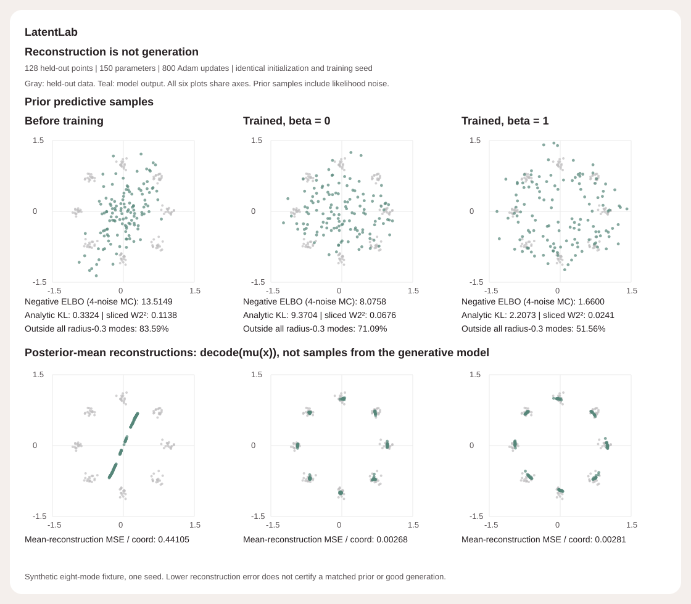
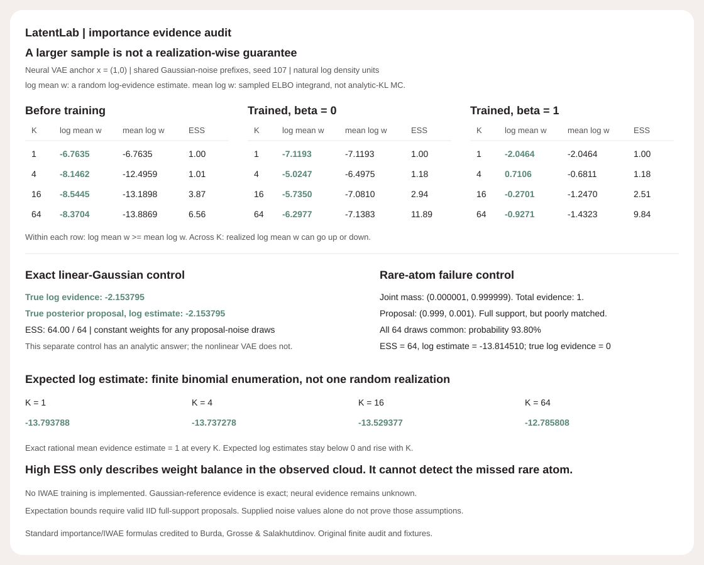

# LatentLab

A Gaussian variational autoencoder built from scalar Python operations. No NumPy, PyTorch, autograd, downloaded data or hosted model. The encoder, stochastic latent path, analytic KL, decoder and every parameter gradient are inspectable.

The interesting result is a failure of reconstruction as a generation metric. On the included eight-mode fixture, removing the KL term gives slightly **lower posterior-mean reconstruction error**, yet worse prior samples and a much higher negative ELBO. The beta 1 model improves generation but still puts **51.56%** of its noisy prior samples farther than radius 0.3 from every data mode. This is not a solved generation benchmark.



## Importance evidence audit (v0.2)

The new [importance audit](IMPORTANCE.md) separates random log-evidence estimates, expected IWAE bounds and same-sample Jensen comparisons. Log-space weights preserve every latent/proposal/joint witness. For the original trained beta 1 model at x=(1,0), shared noise prefixes give log estimates -2.0464, 0.7106, -0.2701, -0.9271 for K=1,4,16,64: larger prefixes are not realization-wise guarantees. Actual nonlinear evidence is unknown.

An independent linear-Gaussian exact-posterior control recovers log evidence -2.153795. A two-atom full-support control has **ESS 64 while underestimating evidence by factor 999,000**, on an event with probability **93.80%**. Exact rational enumeration verifies unbiased mean evidence and the increasing expected-log hierarchy, which still remains far from the truth. This adds evidence diagnostics, not IWAE training or an ESS accuracy certificate.



```sh
python -m latentlab importance-demo > /tmp/importance-demo.json
python -m latentlab importance examples/importance-input.json > /tmp/anchor.json
python examples/render_importance.py --check
```

43 tests now pass (25 original, 15 importance, 3 new figure tests). The original demo and SVG are unchanged. The five-module v0.2 wheel reproduces both demos outside checkout; all 48 new table cells, complete witness metadata, extreme-log underflow reporting, independent Gaussian quadrature references and rare-event probabilities are tested. Standard importance/IWAE results credit Burda, Grosse & Salakhutdinov, [Importance Weighted Autoencoders](https://arxiv.org/abs/1509.00519), Section 3. [IMPORTANCE.md](IMPORTANCE.md) states the exact assumptions and limits.

## Run offline

Python 3.10+. Runtime and tests use the standard library only.

```sh
python -m latentlab demo > /tmp/demo.json
python -m unittest discover -s tests -v
python examples/render_audit.py --check
# Optional packaging (requires setuptools and wheel):
pip install --no-deps --no-build-isolation .
latentlab demo > /tmp/installed-demo.json
```

The demo trains both arms for 800 updates on 128 synthetic points, then evaluates 128 separately generated held-out points. Training uses fresh Gaussian noise on every example/update. Evaluation uses four held-fixed draws per held-out point. Both arms share the same initial weights, training-data stream and noise stream. No validation-based selection or best-seed search is performed.

## Measured default fixture

| Held-out metric | Before training | beta 0 (no KL) | beta 1 (negative ELBO) |
|---|---:|---:|---:|
| Negative ELBO, fixed four-noise MC | 13.5149 | 8.0758 | 1.6600 |
| Analytic posterior KL to standard normal | 0.3324 | 9.3704 | 2.2073 |
| Mean reconstruction MSE / coordinate | 0.44105 | 0.00268 | 0.00281 |
| Prior-sample sliced W2 squared, 32 directions | 0.1138 | 0.0676 | 0.0241 |
| Samples outside all eight radius 0.3 modes | 83.59% | 71.09% | 51.56% |

Samples are from `z ~ N(0,I)` **and** `x ~ N(decoder(z),0.2² I)`, not just decoder means. Reconstructions are `decoder(mu(x))`, not posterior predictive draws. The plot has six equal-axis panels and encodes the complete measured JSON report, including both trained checkpoints. Source data, all 128 predictions per arm, losses, histories and 150 parameters are in [examples/demo.json](examples/demo.json).

The comparisons are descriptive for this particular seed, tiny data, architecture and training budget. They do not isolate a universal causal mechanism or establish superiority over another model. Sliced transport uses an empirical fixed direction grid, not the full Wasserstein distance. Radius0.3 is a disclosed fixture diagnostic, not a calibrated support test.

## What is implemented

- Two-dimensional observations and latent variables; one 12-unit tanh hidden layer in each direction; **150 learned scalar parameters**.
- Diagonal Gaussian posterior with smoothly bounded logvariance: `ell = 4 tanh(raw/4)`. This is a modeling constraint, not silent hard clipping.
- Reparameterization `z = mu + exp(ell/2) * epsilon`; hand-derived pathwise gradients through every layer and the bounded logvariance.
- Fixed Gaussian observation standard deviation 0.2; analytic KL to a two-dimensional standard normal. Likelihood constants are included, so continuous negative log likelihood can be negative.
- Adam with bias correction; explicit independent RNG streams; full-batch averaging within each sampled minibatch. No gradient clipping, annealing or cherry-picked checkpoint.
- Strict versioned checkpoint import, detached export, reproducible inference and sampling; no pickle execution.
- Held-fixed Monte Carlo negative-ELBO audit, analytic KL, deterministic mean reconstruction, noisy prior sampling, sliced transport and disclosed mode counts.

Only beta 1 is the ordinary negative-ELBO objective. Other beta values weight the KL term and must not be described as that same bound. The four-noise evaluation is a **Monte Carlo estimate**, not exact marginal likelihood, exact expected ELBO or a guaranteed sample-wise bound on negative log evidence. The analytic bound applies to the expectation over the posterior.

## API

```python
from latentlab import VAE, train, evaluate, sample

model = VAE(hidden=12, sigma=0.2, seed=7)
terms, gradient = model.loss_grad([0.8, 0.1], [0.4, -0.7], beta=1.0)
assert len(gradient) == 150
# Explicit fixed epsilon makes all parameters independently differentiable.
checkpoint = model.to_dict()
restored = VAE.from_dict(checkpoint)
assert restored.decode([0.2, 0.3]) == model.decode([0.2, 0.3])
```

`train` mutates the model, validates all data/config before updating, and returns sparse training-batch objective history. History entries are noisy sampled batch losses, not full-data learning curves. `evaluate` never changes weights. The CLI emits sorted finite JSON; exits 0 when the two disclosed fixture gates pass, 1 when a gate fails and 2 for invalid arguments. `--steps 0` deliberately fails the improvement gate. Gates do not certify generalization or density recovery.

## Verification

**The 25 original tests** cover:

- Central finite differences against a separately implemented flat-cursor objective for every parameter at hidden sizes 2, 3, 12 and beta 0, 1, 4 (nine full-gradient settings), plus an averaged fixed-noise batch reference.
- Bounded-logvariance chain rule in saturation, zero-model analytic Gaussian loss, exact-prior KL, beta-objective distinctions and a separately computed first Adam update.
- Strict checkpoint schema/shape/finite validation, deterministic training, no global RNG changes, no data mutation, no updates on invalid inputs, zero-step behavior and CLI failure paths.
- Tiny exact sliced-distance identities, separate likelihood-noise streams, real default training, reconstruction/prior distinctions and an origin-collapse control.
- Byte-reproducible SVG, all 12 displayed metric lines, all 1536 scatter-point coordinates and shared-axis geometry, full compressed-report metadata, and detection of a hidden parameter change.

CI runs Python 3.10-3.13 tests, both real demos, both figure checks, wheel build and installed CLI outside the checkout. Installed and source demos are compared as complete JSON objects. Cross-version last-bit float identity of a committed fixture is not promised.

## Attribution and limits

Reparameterized variational autoencoding and the analytic Gaussian KL follow Kingma & Welling, [Auto-Encoding Variational Bayes](https://arxiv.org/abs/1312.6114), particularly Sections 2-3 and Appendices B-C. This is an original small implementation and synthetic audit, not a new algorithm, reproduction of their experiments, pretrained model or production library. [DESIGN.md](DESIGN.md) states the exact objective and derivative paths.

One two-dimensional toy dataset, one default seed, diagonal posterior, bounded posterior variance, fixed observation noise, small neural nets and a short training budget. No image generation, disentanglement, likelihood estimate, posterior-exactness guarantee, uncertainty calibration, high-dimensional scaling or broad robustness claim. MIT.
